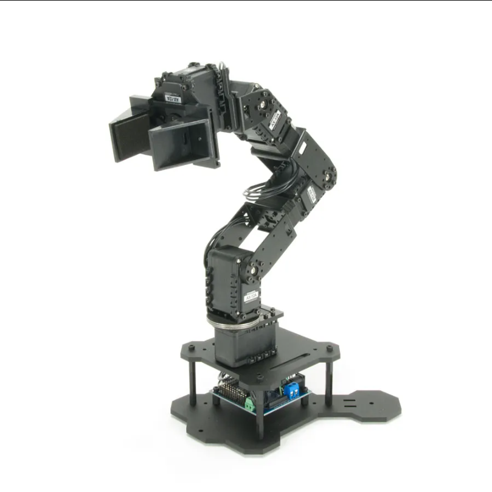
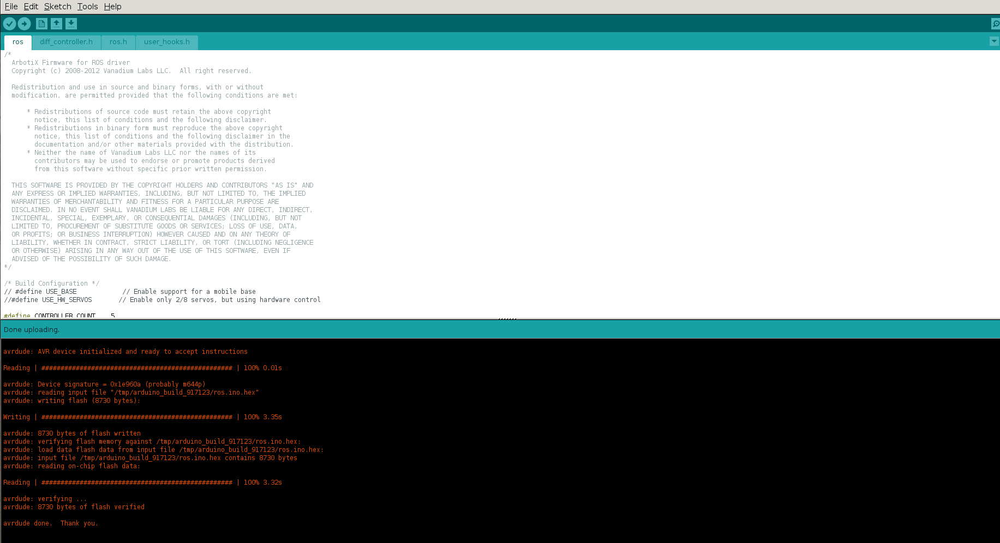

# PhantomX Pincher Arm

This repository includes the ROS1 and ROS2 codebases used to control the
PhantomX Pincher robotic arm.

<p align="center">
  
</p>

The ROS1 implementation is based on the following upstream projects:

- [ArbotiX support for Arduino IDE 1.8](https://github.com/tician/arbotix/tree/arduino-1.8)
- [arbotix_ros for ROS 1 Noetic](https://github.com/vanadiumlabs/arbotix_ros/tree/noetic-devel)

Several modifications were made to these packages so they compile correctly,
support the complete robotic arm including the end effector, and work with
MoveIt under ROS1 Noetic.


# Table of Contents

- [PhantomX Pincher Arm](#phantomx-pincher-arm)
- [Table of Contents](#table-of-contents)
  - [Repository layout](#repository-layout)
- [System requirements](#system-requirements)
  - [Hardware](#hardware)
  - [Software](#software)
  - [Safety precautions](#safety-precautions)
- [Firmware flash](#firmware-flash)
  - [ArbotiX-M and Arduino IDE](#arbotix-m-and-arduino-ide)
    - [Step 1: Install Arduino IDE 1.8](#step-1-install-arduino-ide-18)
    - [Install the ArbotiX board definition and libraries](#install-the-arbotix-board-definition-and-libraries)
  - [Programming ROS firmware in the robot](#programming-ros-firmware-in-the-robot)
- [ROS1 installation](#ros1-installation)
  - [Installing ROS1 Noetic and MoveIt](#installing-ros1-noetic-and-moveit)
  - [Configure access to the serial port](#configure-access-to-the-serial-port)
  - [Running ROS1 MoveIt node](#running-ros1-moveit-node)
  - [Use MoveIt in RViz](#use-moveit-in-rviz)
  - [Useful files to modify](#useful-files-to-modify)

## Repository layout

The relevant directories are expected to have the following structure:

```text
├── Arduino board/
│   ├── Arduino/
│   │   ├── hardware/
│   │   └── libraries/
│   ├── arbotix_firmware/
│   │   └── src/
│   │       └── ros/
│   │           └── ros.ino
│   ├── PhantomX_test_code_no_ROS/
│   │   └── PhantomX_test_code_no_ROS.ino
│   └── arduino-1.8.3-linux64.zip
├── CPP_test/
│   ├── arbotix_driver.cpp
│   ├── arbotix_driver.hpp
│   ├── main.cpp
│   └── main_rw_test.cpp
├── Docker/
│   ├── bashrc
│   ├── docker-entrypoint.sh
│   ├── Dockerfile
│   └── sim-start.sh
├── ROS1/
│   └── src/
│       ├── arbotix/
│       │   ├── arbotix/
│       │   ├── arbotix_controllers/
│       │   ├── arbotix_firmware/
│       │   ├── arbotix_msgs/
│       │   ├── arbotix_python/
│       │   └── arbotix_sensors/
│       └── phantomx_pincher_arm/
│           ├── phantomx_pincher_arm/
│           ├── phantomx_pincher_arm_bringup/
│           │   ├── config/
│           │   ├── launch/
│           │   ├── script/
│           │   └── src/
│           ├── phantomx_pincher_arm_description/
│           │   ├── launch/
│           │   ├── meshes/
│           │   ├── robots/
│           │   └── urdf/
│           └── phantomx_pincher_arm_moveit_config/
│               ├── config/
│               └── launch/
├── readme_images/
│   ├── board_flash.png
│   └── pincher_arm.png
├── rules/
│   └── 99-phantomx.rules
└── README.md
```

The main folders contain the following elements:

- **`Arduino board/`**: contains the Arduino IDE files, ArbotiX board
  definitions and libraries, the firmware uploaded to the ArbotiX-M controller,
  and a standalone test program that can be used without ROS.

- **`CPP_test/`**: contains standalone C++ programs used to develop and test the
  ArbotiX serial communication driver independently from ROS.

- **`Docker/`**: contains the files required to build and initialize the Docker
  environment used by the project.

- **`ROS1/`**: contains the ROS1 Noetic implementation of the PhantomX Pincher
  arm, including the original ArbotiX ROS packages, robot description, bringup
  configuration, and MoveIt configuration.

- **`readme_images/`**: contains the images used in this README.

- **`rules/`**: contains the udev rule used to configure access to the
  PhantomX/ArbotiX USB serial device.

All commands below assume that the terminal is initially opened in the root of
this repository.

# System requirements

## Hardware

- PhantomX Pincher robotic arm;
- ArbotiX-M controller board;
- the correct external power supply for the arm and Dynamixel servos;
- a data-capable USB cable;
- an AMD64 computer with an Intel or AMD processor.

## Software

- Ubuntu 20.04 LTS, 64-bit for ROS1 Noetic
- Arduino IDE 1.8.x;
- ROS 1 Noetic with MoveIt 1, or ROS2 Humble with MoveIt 2;
- Git;
- the standard Catkin build tools for ROS1

**NOTE:** We have added the Arduino installer in this repository, so Git LFS is
required in order to clone it entirely. Here is how to install this extension
for Git for Ubuntu:

```bash
curl -s https://packagecloud.io/install/repositories/github/git-lfs/script.deb.sh | sudo bash &&
sudo apt update && sudo apt install -y --no-install-recommends git-lfs
```

## Safety precautions

> [!WARNING] The arm may move immediately after the controller starts. Keep
> people, cables, and objects outside its workspace. Put the robot in a stable,
> unobstructed position before applying servo power, and be ready to disconnect
> the external power supply.

- Do not power the servos from the computer's USB port.
- Use the voltage and polarity required by the ArbotiX-M board and the installed
  servos.
- Switch off servo power before manually repositioning the arm.
- During the first test, use a large free workspace and conservative motions.
- Do not execute a trajectory if the RViz model does not match the physical
  pose.

# Firmware flash

## ArbotiX-M and Arduino IDE

The ArbotiX-M board is based on an Atmel MCU, similarly to Arduino boards.
Therefore, it is compatible with the Arduino IDE. The board includes a USB
connector that allows it to be connected to a PC and programmed. To use the
Arduino IDE with the ArbotiX-M board, we need to provide the required hardware
definitions and libraries so that the software knows how to interact with the
board. Once these files are installed, we can upload code to the Atmel MCU and
control the servo motors directly, without ROS.

In our case, we want to command the robot remotely from the PC. Thus, we need to
load a firmware program into the Atmel MCU that waits for messages coming from
the PC and forwards the corresponding commands to the servos. The following
sections describe how to install the required Arduino environment and flash this
firmware.

### Step 1: Install Arduino IDE 1.8

The ArbotiX-M support files used by this project rely on the legacy Arduino 1.8
toolchain. The provided setup has been tested with Ubuntu 20.04, either natively
or inside the Docker environment included in this repository.

The Arduino 1.8 installer file is in the folder [Arduino
board](Arduino%20board/), as the ZIP file
[arduino-1.8.3-linux64.zip](Arduino%20board/arduino-1.8.3-linux64.zip).

Uncompress the file, and run the script `install.sh` to install the software.
Then, run the executable file `arduino` located in the same folder as the
`install.sh` script.

```bash
cd Arduino\ board;
unzip arduino-1.8.3-linux64.zip;                         ## Uncompress Arduino IDE installer
sudo ./arduino-1.8.3-linux64/arduino-1.8.3/install.sh;   ## Install Arduino IDE
./arduino-1.8.3-linux64/arduino-1.8.3/arduino;           ## Run Arduino IDE
```

Start Arduino IDE once, then close it. This creates the Arduino user directory
if it does not already exist.

### Install the ArbotiX board definition and libraries

Copy the folder called `Arduino` into your `$HOME` directory.

```bash
cd Arduino\ board;         ## Go to the Arduino board directory
cp -r ./Arduino $HOME;     ## Copy the hardware and libraries folders into $HOME
```

The resulting installation should contain ArbotiX-related files under paths such
as:
```text
~/Arduino/hardware/
~/Arduino/libraries/
```

Open the Arduino IDE and, in the menu `Tools -> Board`, you should now see the
`ArbotiX-M` board available. Select it.

Connect the PhantomX Pincher robotic arm to your computer. In the menu
`Tools -> Port` of the Arduino IDE, you should see a device such as
`/dev/ttyUSBX`, where `X` is a number starting from 0.

To identify the port from a terminal, compare the output of the following command
before and after connecting the board:

```bash
ls -l /dev/ttyUSB* 2>/dev/null
```

At this point, the Arduino IDE is installed and configured to program the
ArbotiX-M controller.

## Programming ROS firmware in the robot

Place the arm in a safe position. It is preferable to leave the servo power
switched off while uploading the firmware.

Connect the robot to the computer and open the Arduino IDE with the
configuration described above. Go to the menu `File -> Open`, and navigate to
this repository folder, then to `Arduino board -> arbotix_firmware -> src -> ros`,
and select the `ros.ino` file.

Then, go to the menu `Sketch -> Upload`. The Arduino IDE will first compile the
program and then upload it to the ArbotiX-M board. If everything works
correctly, you should see a message like this one:

<p align="center">
  
</p>

After a successful upload:

1. close Arduino IDE and its Serial Monitor;
2. disconnect the USB cable;
3. wait a few seconds;
4. reconnect the USB cable;
5. check that the serial device appears again.

The ArbotiX-M board is now running the firmware that receives commands from the
ROS driver over USB.

# ROS1 installation

## Installing ROS1 Noetic and MoveIt

Now, we want to command the robot using ROS1 Noetic. ROS1 Noetic targets Ubuntu
20.04. First of all, we have to install ROS. The full instructions are
[here](https://wiki.ros.org/noetic/Installation/Ubuntu).

> [!NOTE] ROS1 Noetic reached end-of-life on May 31, 2025. This section is kept
> to support the ROS1 version of this repository.

Briefly, you have to run the following commands:

```bash
sudo sh -c 'echo "deb http://packages.ros.org/ros/ubuntu $(lsb_release -sc) main" > /etc/apt/sources.list.d/ros-latest.list' &&
sudo apt-key adv --keyserver keyserver.ubuntu.com --recv-keys F42ED6FBAB17C654 && \
sudo apt update && \
sudo apt install -y --no-install-recommends curl &&
curl -s https://raw.githubusercontent.com/ros/rosdistro/master/ros.asc | sudo apt-key add - &&
sudo apt update &&
sudo apt install -y --no-install-recommends ros-noetic-desktop-full &&
sudo apt update &&
sudo apt install -y --no-install-recommends \
    python3-rosinstall \
    python3-rosinstall-generator \
    python3-wstool \
    build-essential \
    ros-noetic-moveit \
    python3-rosdep && \
sudo rosdep init && \
rosdep update && \
python3 -m pip install pyserial opencv-python numpy matplotlib
```

This process will take a while, depending on your computer and your internet
connection. Once finished, you need to source the setup file. If you use bash as
the default terminal, run:

```bash
echo "source /opt/ros/noetic/setup.bash" >> ~/.bashrc
source ~/.bashrc
```

If your default terminal is zsh, run:

```bash
echo "source /opt/ros/noetic/setup.zsh" >> ~/.zshrc
source ~/.zshrc
```

## Configure access to the serial port

Ubuntu normally assigns `/dev/ttyUSB*` devices to the `dialout` group. Add the
current user to that group:

```bash
sudo usermod -aG dialout "$USER"
```

Log out of the graphical session and log back in, or reboot the computer.
Opening a new terminal alone is not sufficient.

After logging back in, verify the group and device permissions:

```bash
groups
ls -l /dev/ttyUSB* 2>/dev/null
```

The output of `groups` should contain `dialout`. Do not work around permission
problems by launching ROS with `sudo` or by permanently setting the device to
mode `777`.

## Running ROS1 MoveIt node

Once the Arduino firmware is flashed on the PhantomX Pincher robot and ROS1
Noetic is installed, we can compile and run the MoveIt node together with RViz.
All the required models, URDFs, and code for this module are in the ROS1 folder.
We compile with `catkin_make`, and then we launch the `moveit.launch` program.
We assume you are using bash as the default terminal.

Before starting the ROS nodes, check that the baud rate and the device path are
correct. The default baud rate is set to 57600, and the default device path is
`/dev/ttyUSB0`. If this configuration changes, update the corresponding
parameters in the launch file located at:

`ROS1/src/phantomx_pincher_arm/phantomx_pincher_arm_bringup/launch/arm.launch`.

Finally, use the following instructions to launch the program:

```bash
cd ROS1;
catkin_make;
source ./devel/setup.bash;
roslaunch phantomx_pincher_arm_bringup moveit.launch;
```

This launch file will simultaneously bring up the robot communication node,
publish the `robot_description`, start the MoveIt controller, and finally launch
the RViz visualization tool.

**NOTE:** The USB cable does not power the servo motors. Thus, in order to use
the arm, connect the corresponding power source to the robotic arm.

## Use MoveIt in RViz

After RViz opens:

1. check that the robot model is visible and that its pose matches the physical
   arm;
2. check that the **Fixed Frame** does not report an error;
3. open the **MotionPlanning** panel;
4. select the arm's configured planning group, commonly named `arm`;
5. drag the interactive end-effector marker to a nearby, collision-free target;
6. click **Plan** and inspect the animated trajectory;
7. only if the trajectory is safe, click **Execute**.

Start with small movements. If planning succeeds in RViz but the physical arm
does not move, check the controller state and serial connection before trying
again.

## Useful files to modify

Some low-level configurations of the robot can be changed by modifying the
following configuration files:

- [phantomx_pincher_arm.yaml](ROS1/src/phantomx_pincher_arm/phantomx_pincher_arm_bringup/config/phantomx_pincher_arm.yaml):
  This file contains the motor IDs, the driver type, the servo tick
  corresponding to the neutral position (0 degrees), and the parameter used to
  invert the servo motion direction.

- [phantomx_pincher_arm.srdf](ROS1/src/phantomx_pincher_arm/phantomx_pincher_arm_moveit_config/config/phantomx_pincher_arm.srdf):
  This is the main MoveIt semantic configuration file. It defines planning
  groups, group states corresponding to predefined robot positions, and
  collision pairs that can be disabled.

- [pincher_arm.urdf](ROS1/src/phantomx_pincher_arm/phantomx_pincher_arm_description/urdf/pincher_arm.urdf):
  This is the main URDF file of the PhantomX Pincher robot currently used by the
  ROS1 implementation.
